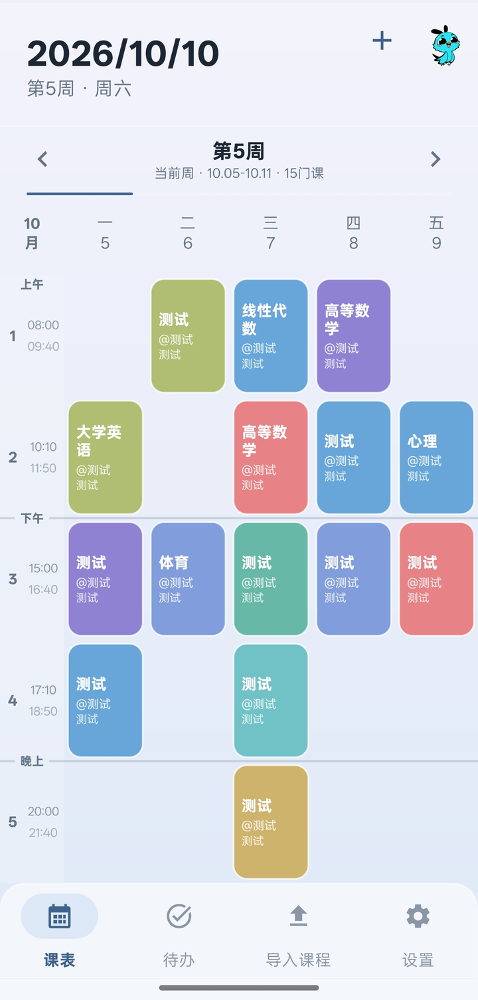
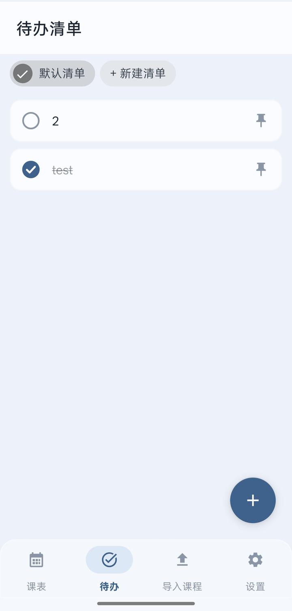
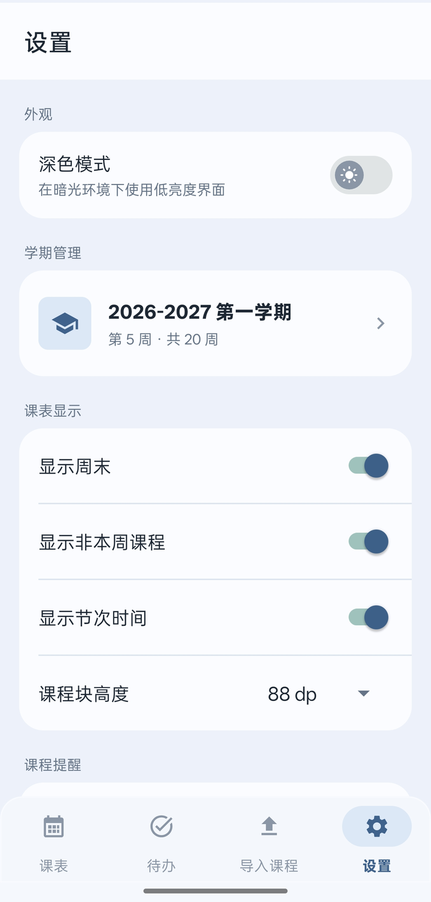

# HtuList

> 一个**本地优先**的 Android 课表 + 待办清单应用。
> 课表、待办、提醒都在本机，不注册账号、不上传数据、不需要自建服务器。

<p align="center">
  
  
  
</p>

---

## 特点

大多数课表 App 按「一天 12 小节」排课，但不少学校实际用的是**大节制**：一天 5 大节、每节 100 分钟。

HtuList 直接以大节制作息为默认：

| 大节 | 时间 | 大节 | 时间 |
|---|---|---|---|
| 第 1 大节 | 08:00 – 09:40 | 第 4 大节 | 17:10 – 18:50 |
| 第 2 大节 | 10:10 – 11:50 | 第 5 大节 | 20:00 – 21:40 |
| 第 3 大节 | 15:00 – 16:40 | | |

每一节的开始 / 结束时间都能在设置里改，改完表里的**上午 / 下午 / 晚上**分界线和课程提醒会跟着一起走（分界线按相邻大节的时间间隔自动判断，不是写死的下标）。

**装好之后是空课表**，课程需要自己添加或导入。

## 功能

**课表**
- 左右跟手切换周次，或拖周次进度条快速跳周；每周保留独立的纵向滚动位置
- 长按课表空白处拖动，直接按「当前周 / 对应星期 / 节次」新建课程
- 编辑、删除、单双周、**自定义周次**（`6 / 9 / 12 / 15 周` 这类离散周次装得下）、课程配色、备注、时间冲突检测
- 每节课时间可自定义，课程块高度可调
- 深色模式（切换是缓慢渐变，不闪屏）

**待办**
- 勾选两态、置顶、多行备注、多清单分组、到期提醒
- 圆形勾选框为自绘（不用 `CheckBox`，避免部分国产 ROM 强制染色）

**导入 / 备份**
- `.xlsx` / JSON / CSV / HTML / 纯文本导入，导入前预览并检查重复与冲突
- 可在应用内登录教务网页读取课表
- 当前学期完整备份导出 / 恢复，导入覆盖后可撤销

**提醒**
- 课前通知，可设默认提前时间并批量应用到本学期课程
- 内置提醒权限自检，系统关掉通知或精确闹钟时会直接提示

## 下载安装

到 **[Releases](../../releases)** 下载最新的 `HtuList-vX.Y.Z.apk`，在手机上打开安装即可。

- 系统要求：Android 8.0（API 26）及以上
- 首次安装需在系统里允许「安装未知来源应用」
- 目前只提供 debug 签名的直装包，未上架任何应用商店

## 构建

需要 JDK 17 与 Android SDK 34：

```bash
export JAVA_HOME=<你的 JDK17 路径>
export ANDROID_HOME=<你的 Android SDK 路径>

# 仓库根就是 Gradle 工程根
./gradlew.bat assembleDebug        # Windows
# 产物：app/build/outputs/apk/debug/app-debug.apk
```

| 项 | 值 |
|---|---|
| 语言 | Kotlin 1.9.10 |
| UI | View + ViewBinding / DataBinding（无 Compose） |
| 数据库 | Room v3（v1→v2、v2→v3 均为显式 Migration，不会清空课表） |
| 构建 | AGP 8.1.2 / Gradle 8.5 |
| minSdk / targetSdk | 26 / 34 |

## 仓库结构

```
.
├── app/                  应用模块：Kotlin 源码 + 资源
│   └── src/main/
│       ├── java/com/courseschedule/
│       ├── res/          布局、颜色、字符串、图标
│       └── assets/       教务目录等只读数据
├── design/               应用图标设计稿（原创）
├── docs/screenshots/     README 用的截图
├── gradle/               Gradle Wrapper
├── build.gradle
└── settings.gradle
```

## 已知限制

- **仅 Android**。iOS 没有对应版本，也无法像 APK 一样旁路安装。
- 桌面小组件、系统日历联动**未实现**（前者受启动器刷新时机限制，后者底座本身已有提醒，重复实现意义不大）。
- 教务系统导入依赖学校页面结构，学校改版后可能需要跟进适配。

## 开源与致谢

- 课表底座基于 **[cakeni/CourseSchedule](https://github.com/cakeni/CourseSchedule)（「晴课表」，MIT 许可）** 二次开发，在此致谢。原始版权声明保留在 [LICENSE](LICENSE)。
- 待办模块的数据模型参考 **Todometer**（Apache-2.0），实现上做过多处简化。
- 应用图标为原创设计，未沿用上游素材。

本仓库自身同样以 **MIT 许可**发布，详见 [LICENSE](LICENSE)。

## 反馈

有问题或建议请提 [Issue](../../issues)。反馈教务系统适配时，请附上**脱敏后**的课表页面样本，不要贴学号、姓名等个人信息。
